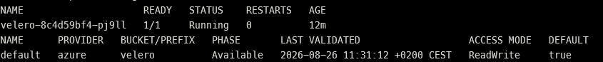

# Velero Installation

## Result

Velero was installed in AKS with the Microsoft Azure object-store plugin and
Microsoft Entra Workload Identity.

| Component | Version or status |
|---|---|
| Velero server | v1.17.2 |
| Azure plugin | v1.13.0 |
| Velero deployment | `Ready` |
| Velero pod | `Running` |
| BackupStorageLocation | `Available` |
| Storage access mode | `ReadWrite` |
| Azure credential Secret | Not created |

The server and plugin versions follow the compatibility matrix published by
the Microsoft Azure plugin project.

## Authentication

The `velero` Kubernetes ServiceAccount is annotated with the client ID of the
dedicated Azure managed identity. Its pod template carries the required
`azure.workload.identity/use: "true"` label.

```text
Velero pod
  -> Kubernetes ServiceAccount
  -> AKS OIDC issuer
  -> federated identity credential
  -> Microsoft Entra access token
  -> private Azure Blob container
```

No Azure client secret or Storage account key is stored in Kubernetes. Velero
creates its own internal repository-credentials Secret, which is unrelated to
Azure authentication. The managed identity has `Storage Blob Data Contributor`
scoped to the backup Storage account.

## Installation configuration

The installation uses the Azure provider and object-store plugin with the
following controls:

- `useAAD=true` enables Microsoft Entra authentication;
- the direct Storage Blob endpoint avoids an additional Reader role;
- the `velero` container is the default backup location;
- volume snapshots are disabled because the mandatory demonstration protects
  Kubernetes objects rather than Azure managed disks;
- no Azure provider credential Secret is created.

Representative installation command:

```bash
velero install \
  --image velero/velero:v1.17.2 \
  --provider azure \
  --plugins velero/velero-plugin-for-microsoft-azure:v1.13.0 \
  --bucket velero \
  --backup-location-config \
useAAD=true,storageAccountURI=https://velerolab1vc7q1.blob.core.windows.net,storageAccount=velerolab1vc7q1,resourceGroup=hmezouarRG,subscriptionId=<SUBSCRIPTION_ID> \
  --use-volume-snapshots=false \
  --no-secret \
  --pod-labels azure.workload.identity/use=true \
  --sa-annotations azure.workload.identity/client-id=<MANAGED_IDENTITY_CLIENT_ID> \
  --wait
```

Subscription and identity identifiers are resolved from authenticated Azure
and Terraform contexts and are not committed to the repository.

## Verification

The installation is accepted only when all of the following are true:

```bash
kubectl get pods -n velero
velero version
velero backup-location get
```

Validated result:

```text
Velero pod:               Running, 1/1 Ready, 0 restarts
Client/server version:    v1.17.2
Provider:                 azure
Bucket:                   velero
Backup location phase:    Available
Access mode:              ReadWrite
```

The first controller reconciliation briefly reported the backup location as
unknown while the plugin initialized. The next validation succeeded and the
location remained `Available`.

## Evidence

The relevant assessment evidence is a terminal capture showing both the Velero
pod in `Running` state and the BackupStorageLocation in `Available` state.
Credentials, identity identifiers, and signed URLs must not appear in evidence.


