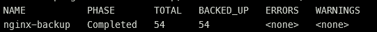
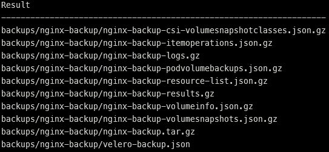

# Manual Velero Backup

## Objective

A manual backup named `nginx-backup` protects the complete `nginx-demo`
namespace and stores the resulting objects in the private Azure Blob container.

## Backup operation

```bash
velero backup create nginx-backup \
  --include-namespaces nginx-demo \
  --wait
```

The namespace-level scope includes the Nginx Deployment, ReplicaSet, pods,
Service, ConfigMap, namespace metadata, and related Kubernetes objects selected
by Velero.

## Velero verification

The backup custom resource reported:

| Property | Result |
|---|---|
| Backup | `nginx-backup` |
| Phase | `Completed` |
| Total items | 54 |
| Items backed up | 54 |
| Errors | 0 |
| Warnings | 0 |
| Included namespace | `nginx-demo` |
| Storage location | `default` |

This confirms that every discovered item was processed successfully.

## Azure Blob verification

Azure Blob Storage contained ten objects under the
`backups/nginx-backup/` prefix, including:

- `velero-backup.json`;
- `nginx-backup.tar.gz`;
- `nginx-backup-resource-list.json.gz`;
- `nginx-backup-results.gz`;
- `nginx-backup-logs.gz`;
- metadata for snapshots, pod-volume backups, and item operations.

The presence of these objects independently confirms that the completed backup
was persisted outside the AKS cluster.

## Evidence

The required evidence consists of:

1. Velero backup status showing `Completed`, 54/54 items, zero errors, and zero
   warnings.
2. Azure Blob listing showing objects under `backups/nginx-backup/`.

Evidence must not include signed download URLs, access tokens, Storage keys, or
Blob contents.

### Completed backup



### Azure Blob objects


