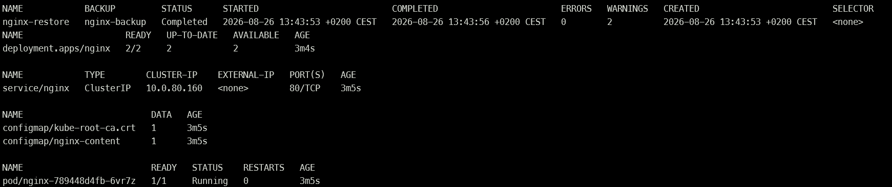

# Velero Restore Test

## Objective

This test proves that the backup is usable, rather than merely present in Blob
Storage. The `nginx-demo` namespace is deliberately deleted and recreated from
the `nginx-backup` backup.

## 1. Delete the protected resources

```bash
kubectl delete namespace nginx-demo --wait=true
kubectl get namespace nginx-demo
```

The second command returned `NotFound`, confirming that the namespace and its
resources were no longer present in the cluster.

## 2. Restore the backup

```bash
velero restore create nginx-restore \
  --from-backup nginx-backup \
  --wait
```

The restore completed with the following result:

| Property | Result |
|---|---|
| Restore | `nginx-restore` |
| Source backup | `nginx-backup` |
| Phase | `Completed` |
| Total selected items | 15 |
| Items restored | 15 |
| Errors | 0 |
| Warnings | 2 |

The warnings concerned cluster-managed objects that already existed:

- the cluster-scoped `ciliumendpoints.cilium.io` CustomResourceDefinition;
- the automatically generated `kube-root-ca.crt` ConfigMap.

These warnings did not affect the application Deployment, Service, application
ConfigMap, or pods. Velero completed the restore without errors.

## 3. Verify the restored application

```bash
kubectl get namespace nginx-demo
kubectl get deployment,service,configmap -n nginx-demo
kubectl rollout status deployment/nginx -n nginx-demo --timeout=180s
kubectl get pods -n nginx-demo -o wide
```

The verification established that:

- the `nginx-demo` namespace was `Active`;
- the `nginx` Deployment reached `2/2` available replicas;
- the `nginx` ClusterIP Service was recreated;
- the `nginx-content` ConfigMap was recreated;
- both application pods were `Running` with zero restarts.

## Conclusion

The end-to-end recovery objective was achieved. Velero successfully read the
backup from the private Azure Blob container and recreated the deleted
Kubernetes resources on AKS.

## Evidence

The retained screenshot shows that `nginx-restore` completed and that the
restored Deployment, Service, ConfigMaps, and application pod are healthy. The
Deployment status of `2/2` confirms that both requested replicas are available.



The evidence does not reveal access tokens, account keys, SAS URLs, or other
credentials.
